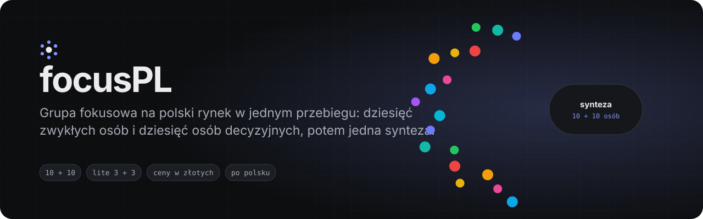
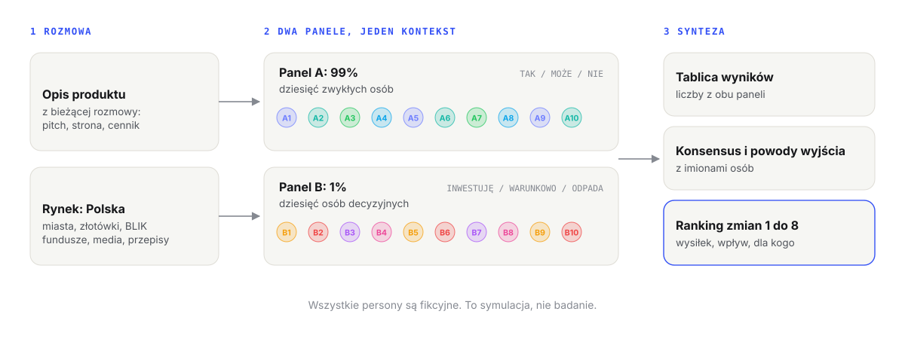

<p align="center">
  
</p>

<p align="center">
  <a href="LICENSE"></a>
  <a href="https://github.com/GameOwerMedia/focusPL/actions/workflows/ci.yml"></a>
  
  
</p>

**focusPL** to skill do Claude Code, który przeprowadza symulowaną grupę
fokusową na polskim rynku: dziesięć zwykłych osób z całej Polski i
dziesięć osób decyzyjnych reaguje na produkt opisany w rozmowie, każda własnym
głosem, a potem jedna synteza liczy werdykty, nazywa, kto się z kim zgadza,
układa ranking zmian, które przekonają najwięcej osób, i mówi wprost, gdzie
pieniądze nie zgadzają się z rynkiem.

Ceny w złotych, BLIK i paczkomaty, Radom obok Warszawy, fundusze, media,
festiwale i przepisy, które naprawdę dotyczą polskich produktów. Całość po
polsku.

> Wersja na rynek światowy, po angielsku: **[focus](https://github.com/GameOwerMedia/focus)**.
> Chcesz, żeby każda persona była osobnym agentem, który naprawdę otwiera Twoją
> stronę albo aplikację? Zobacz **[focus-swarm](https://github.com/GameOwerMedia/focus-swarm)**.

## Przykład

[Przykładowa rozmowa](examples/larder/rozmowa.md) opisuje wejście na polski
rynek fikcyjnej aplikacji *Larder*: wspólna spiżarnia dla domowników, próba z
kartą przechodząca w plan roczny, skanowanie paragonów tylko z dwóch dyskontów
i plan finansowania rabatów danymi o zakupach. Komenda `/focus-pl` dała wynik,
z którego pochodzi fragment poniżej. `[...]` oznacza każde cięcie, a tekst
między cięciami jest skopiowany z [pełnego wyniku](examples/larder/wynik-pelny.md).
Po przebiegu wprowadzono kilka drobnych zmian (poprawki dwóch niejasnych zdań,
ogólne określenia zamiast nazw aplikacji i sieci, jedna poprawka w syntezie);
na początku pliku jest ich pełna lista. Wynik trybu `lite` na tej samej rozmowie
jest w [wynik-lite.md](examples/larder/wynik-lite.md) (3 + 3, około 1800 słów).

```markdown
Rynek: Polska (ceny w złotych, polskie sieci handlowe, zapowiedziane wejście na polski rynek). Skład: 10 + 10. [...]
Wszystkie persony są fikcyjne. Ich reakcje to symulacja, nie dane z badania.

[...]
### A3. Halina Dudek, 67 lat, emerytowana pielęgniarka, wdowa, Ełk
[...]
- **Pierwsze 10 sekund:** „Proszę pani, a co to jest ten larder? Jakieś angielskie słowo. Spiżarnię to ja mam w głowie i w piwnicy. Wnuczka mówi, że syn by widział, co mam w lodówce. A po co mu to? Żeby mnie kontrolował?”
[...]
- **Co nie działa:**
[...]
  - Wszystkie terminy traktowane tak samo. „Na mące jest «najlepiej spożyć przed», a na mięsie «należy spożyć do». To nie to samo [...]
[...]
### B1. Joanna Rybicka, 41 lat, partnerka inwestycyjna, fundusz zalążkowy działający w programie PFR Ventures
[...]
**Pytanie tej osoby:** „Ile z tych 400 gospodarstw dodało jakikolwiek produkt w ósmym tygodniu?”
[...]
- **Werdykt:** WARUNKOWO. „[...] Za dane, których jeszcze nie macie, nie zapłacę wyceną.”
[...]
## Synteza

### 1. Tablica wyników

**Panel A:** TAK 2 (Natalia, Dawid), MOŻE 5 (Agnieszka, Jakub, Oksana, Wiktoria, Sebastian), NIE 3 (Halina, Marek, Stanisław).
**Panel B:** INWESTUJĘ 1 (Krzysztof), WARUNKOWO 6 (Joanna, Aleksandra, Rafał, Michał, Bartosz, Katarzyna), ODPADA 3 (Monika, Ewa, Grzegorz).
[...]
### 4. Zmiany o największym wpływie, ranking 1 do 8
[...]
**2. Próba bez pułapki rocznej.** Karta może zostać, ale próba przechodzi w plan miesięczny, przypomnienie przychodzi kilka dni przed obciążeniem, plan roczny jest osobnym, świadomym wyborem z rabatem. Do tego BLIK.
Naprawia to dla: A1 (strach przed 180 zł naraz), A2 (BLIK), A6 (najpierw miesięcznie), A8 (plan roczny jako jego decyzja), B1 (czysta konwersja do pokazania), B4 (może polecić bez komentarzy o naciągnięciu), B6 (główne ryzyko konsumenckie), B7 (karta tak, automat roczny nie).
**Wysiłek:** niski. **Wpływ:** wysoki.
[...]
### 8. Martwe pola
[...]
- **Polska kuchnia jest w dużej części poza kodem kreskowym.** Każdy w Panelu A zgłosił swoją lukę osobno: słoiki od mamy, targ, jajka od sąsiadki, przetwory i zamrażarka, dostawy z maila, Żabka, lodówka społeczna. [...]
```

## Dlaczego

Większość promptów typu „co powiedzieliby użytkownicy” zwraca jednego
uprzejmego recenzenta podpisanego dwudziestoma imionami. Ten skill jest
zbudowany przeciwko temu:

- **Dwie sale, nie jedna.** Ludzie, którzy mieliby z produktu korzystać, i
  ludzie, którzy decydują o pieniądzach, dystrybucji albo kontrakcie, oceniają
  go w różnych walutach. Synteza pokazuje, gdzie się nie zgadzają, zamiast
  uśredniać.
- **Zasady obsady zamiast przypadku.** Panel A rozpięty jest między wiekiem,
  dochodem, obyciem z technologią, wielkością miejscowości i stosunkiem do
  produktu, ma sceptyka kategorii i osobę spoza grupy docelowej, a także
  cudzoziemca mieszkającego w Polsce. Panel B ma stałe miejsca (pieniądze,
  dostęp do odbiorców, operacje, strategia, ekspert) i co najmniej trzy osoby
  sceptyczne albo wrogie.
- **Liczby i imiona.** Każde zdanie w syntezie mówi, kto je wypowiedział.
  Ranking zmian pokazuje, kogo dana zmiana przekonuje, więc widać, czy pomaga
  tym, którzy wyszli z sali, czy tylko tym, którzy i tak byli na tak.
- **Żadnych zmyślonych faktów.** Bez wymyślonych statystyk, kwot grantów,
  terminów naborów i cytatów. Prawdziwe instytucje, fundusze i media są wymienione
  jako kontekst rynku (lista jest w pliku rynku) i mogą być miejscem pracy
  persony; same osoby są zawsze fikcyjne.
- **Polszczyzna, nie tłumaczenie.** Prosty język, polskie znaki, bez półpauz i
  pauz. Persony mówią swoim rejestrem: od „proszę pani” po korporacyjny żargon.

## Instalacja

**Jako plugin** (Claude Code 2.x):

```text
/plugin marketplace add GameOwerMedia/focusPL
/plugin install focus-pl@focus-pl
```

Zainstalowany jako plugin skill ma przedrostek z nazwą pluginu: uruchamiasz go
jako `/focus-pl:focus-pl` (i `/focus-pl:focus-pl lite`).

**Ręcznie:** skopiuj `skills/focus-pl` do `~/.claude/skills/` (wszystkie
projekty) albo do `.claude/skills/` w jednym projekcie. Wtedy komenda to po
prostu `/focus-pl` (i `/focus-pl lite`); tej krótszej formy używają przykłady
poniżej. W obu przypadkach możesz też poprosić zwykłymi słowami („zrób grupę
fokusową na polski rynek”).

```bash
git clone https://github.com/GameOwerMedia/focusPL
cp -r focusPL/skills/focus-pl ~/.claude/skills/
```

Bez skryptów, bez zależności, bez dostępu do sieci. Skill to prompt i plik z
kontekstem rynku.

## Szybki start

Opisz produkt w rozmowie (wklej pitch, tekst ze strony, cennik), a potem:

```text
/focus-pl         10 + 10 person, pełna synteza
/focus-pl lite    3 + 3 persony, 5 najważniejszych zmian
```

Możesz też napisać zwyczajnie: „zrób grupę fokusową na polski rynek”, „co by
powiedzieli inwestorzy i zwykli ludzie o tym cenniku?”.

## Jak to działa

<picture>
  <source media="(prefers-color-scheme: dark)" srcset="assets/how-it-works-dark.svg">
  
</picture>

1. **Zrozumienie sali.** Skill wyciąga z rozmowy produkt, odbiorców, model,
   etap, cenę i zasięg, zapisuje założenia w jednym zdaniu i pyta tylko wtedy,
   gdy niejasny jest sam produkt.
2. **Kontekst rynku.** `references/rynek.md` mówi, gdzie mieszkają persony,
   czym płacą, jakie fundusze, media, festiwale i urzędy siedzą w Panelu B i z
   kim porównujemy produkt.
3. **Dwa panele.** Dziesięć recenzji w Panelu A (pierwsze 10 sekund, co działa,
   co nie działa, życzenie, TAK / MOŻE / NIE) i dziesięć w Panelu B (skan w 30
   sekund, obawy, co musi zobaczyć, INWESTUJĘ / WARUNKOWO / ODPADA z warunkami).
4. **Synteza.** Tablica wyników, konsensus, powody do wyjścia z sali, osiem
   zmian w rankingu, pieniądze kontra rynek, linie podziału, głos z
   zewnątrz, ruch strategiczny, martwe pola i nota o rynku światowym.

## Konfiguracja

| Argument | Domyślnie | Działanie |
|---|---|---|
| *(brak)* | | 10 + 10 person, pełna synteza w dziewięciu częściach |
| `lite` | wyłączony | 3 + 3 persony, krótkie recenzje, tablica wyników i 5 zmian |

Kontekst rynku zmienisz w `skills/focus-pl/references/rynek.md`: dopisz
instytucje swojej branży, regionalne fundusze albo media niszowe. Lista
instytucji to przykłady, a nie zamknięty katalog.

## FAQ

**Czy to badanie użytkowników?** Nie. To symulacja, która szybko wyciąga
zastrzeżenia, konflikty i martwe pola. Każde ustalenie traktuj jak hipotezę do
sprawdzenia z prawdziwymi ludźmi.

**Dlaczego persona z PFR Ventures albo z dużej sieci jest fikcyjna?** Bo
wkładanie wymyślonych słów w usta prawdziwej osoby wprowadzałoby w błąd. Skill
może osadzić personę w prawdziwym typie instytucji, ale człowiek jest zawsze
wymyślony, a jego słowa to symulacja.

**Czy skill otwiera mój produkt?** Nie. Pracuje na tym, co jest w rozmowie. Do
agentów, którzy naprawdę wchodzą na stronę, do repozytorium albo w dokument,
służy [focus-swarm](https://github.com/GameOwerMedia/focus-swarm).

**Jak długi jest wynik?** W przykładach około 7000 słów dla 10 + 10 i około
1800 dla `lite`.

**Jaki model?** Najmocniejszy, jaki masz. Na słabszych modelach najpierw
słabnie odrębność głosów i uczciwość syntezy.

## Ograniczenia

- Jeden kontekst mówi za dwadzieścia osób, więc pewne ujednolicenie jest
  nieuniknione. Zasady obsady i zasada „bez znieczulenia” je ograniczają, ale
  go nie usuwają. focus-swarm usuwa je, dając każdej personie osobnego agenta.
- Wiedza o instytucjach jest tak aktualna jak model. Skill nie podaje kwot ani
  terminów naborów, a wszystko, na podstawie czego chcesz działać, sprawdź.
- Jakość wyniku zależy od opisu produktu. Jednozdaniowy pitch daje ogólne
  reakcje.

## Plany

- Profile branżowe w `references/` (fintech, kultura i film, edukacja, zdrowie).
- Opcjonalny argument, który pogłębia jeden z paneli.
- Ewaluacje na stałych przykładowych rozmowach.

## Struktura repozytorium

```text
skills/focus-pl/SKILL.md              skill
skills/focus-pl/references/rynek.md   kontekst polskiego rynku
examples/larder/                      przykładowa rozmowa i prawdziwy wynik
tests/                                testy struktury (python -m unittest)
assets/                               baner i diagramy
```

## Licencja

[MIT](LICENSE). Zmiany mile widziane, zobacz [CONTRIBUTING.md](CONTRIBUTING.md).
